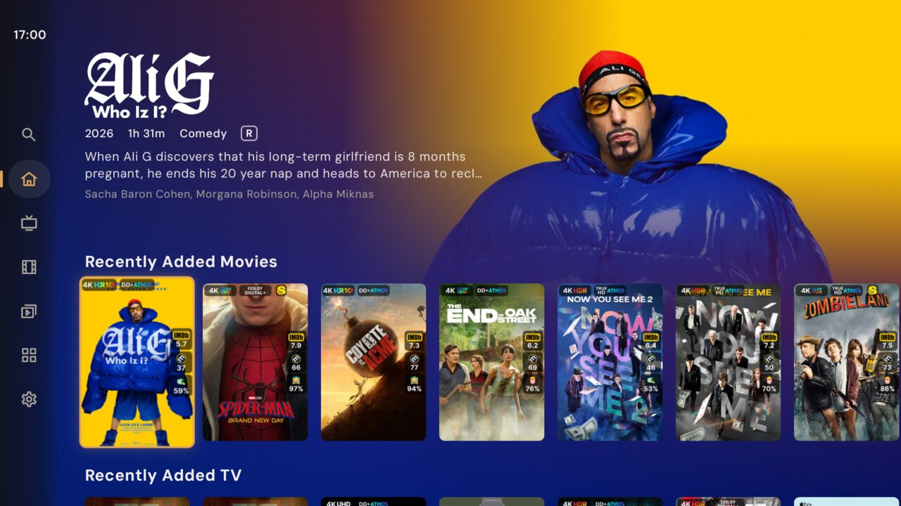
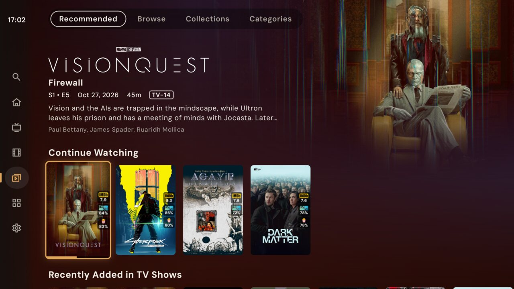

<p align="center"></p>

# Masal

A home screen app for Android TV that brings your Plex library, IPTV live TV and your favourite apps together in one calm interface, laid out the way Plex does it: the title's artwork and colours behind, its logo and details on the left, rows that open like an accordion below.

Masal runs as a normal app next to the system launcher. It was built on an NVIDIA Shield and is designed for a TV remote over HDMI-CEC, so everything works with the D-pad, OK, Back and play/pause.



## Features

- **Home**: your pinned apps, Continue Watching, one live TV row of a channel category you choose, and Plex's own Home rows (Recently Added, collections).
- **Movies and TV Shows**: per Plex library the tabs Recommended, Browse (sort, A–Z jump bar), Collections and Categories, plus detail pages with seasons and episodes.
- **Search** across all Plex libraries and the IPTV channel names, with the TV keyboard and voice input.
- **Live TV** from Xtream logins or M3U playlists with an XMLTV guide; channel switching with all four arrow keys.
- **Plex player** with Plex-style controls, "Ends at" time, subtitle and audio selection, and online subtitle search through your Plex server; choices are saved to Plex.
- **Trailers** play in the background after resting on a title, when Plex has one.
- **Apps page** to pin and order the apps shown on Home.
- **Setup from the phone**: a QR code on the TV opens a setup page in the phone's browser for Plex and IPTV logins. Logins stay on the TV.

## Screenshots

| | |
|---|---|
|  |  |
| TV Shows: Recommended | Browse with sorting and A–Z |
|  |  |
| Live TV row on Home | Search |
|  |  |
| Player | Subtitle search |

Screenshots are rendered from a real library by the JVM tests; artwork belongs to its respective owners.

## Requirements

- Android TV device with Android 8.0 (API 26) or newer.
- For Plex: your own Plex Media Server (link with a code at plex.tv/link, or enter URL and token).
- For live TV: your own IPTV subscription (Xtream login or M3U playlist). Masal does not include or point to any content.

## Build

You need JDK 17 and the Android SDK.

```sh
cp .env.dist .env        # then fill in TV_ADB (and JAVA_HOME / ANDROID_HOME if not set)
./gradlew assembleDebug  # build
scripts/install.sh       # build and install on the TV over network ADB
```

`scripts/install.sh` installs the app; it never starts it. Network ADB must be enabled on the TV (developer options) and this computer allowed once. An optional fallback through Home Assistant's Android TV integration can be configured in `.env`.

## First start

1. Open Masal and go to Settings.
2. Scan the QR code with your phone. The page only runs while Settings is open.
3. Link Plex with the code shown on the TV, or enter the server URL and token.
4. Add an Xtream login or an M3U playlist.
5. Optional: choose the channel category and title for the live TV row on Home.

## Development

- Feature behaviour is described in [`docs/specs/`](docs/specs/README.md); conventions and architecture notes for contributors (and coding agents) are in [`CLAUDE.md`](CLAUDE.md).
- `./gradlew testDebugUnitTest` runs the UI tests on the JVM with Robolectric and writes screenshots, no TV needed. One suite uses a snapshot of your own library (`snapshot/`, never committed) and is skipped without it.

## Fonts and licences

- [DM Sans](https://fonts.google.com/specimen/DM+Sans) for the interface and [Fraunces](https://fonts.google.com/specimen/Fraunces) for the wordmark, both under the SIL Open Font License; see [`licenses/`](licenses/).
- Background photos for apps come from Bing's photo of the day, credited on screen.

Masal is an independent project and is not affiliated with or endorsed by Plex, Inc. or NVIDIA.

## License

The code is released under the [MIT License](LICENSE). The bundled fonts keep their own SIL Open Font License (see [`licenses/`](licenses/)).
