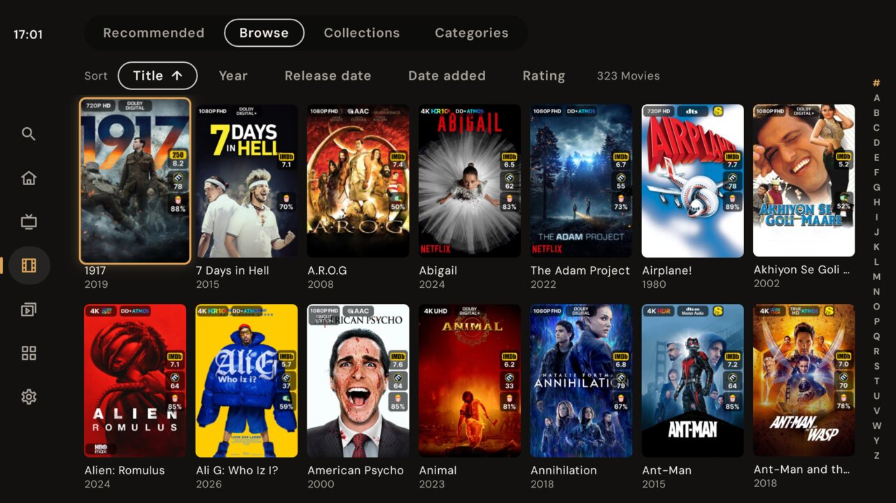
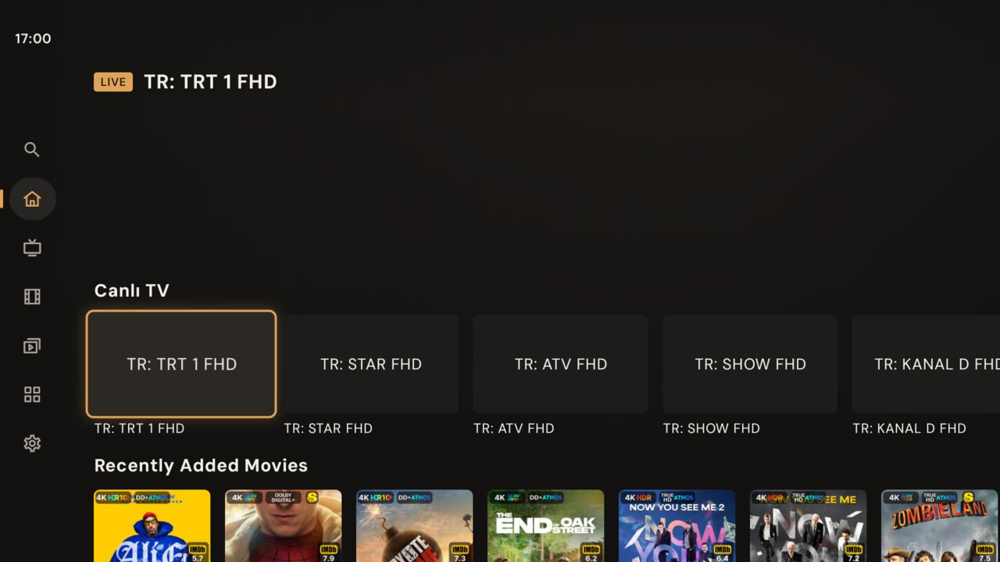
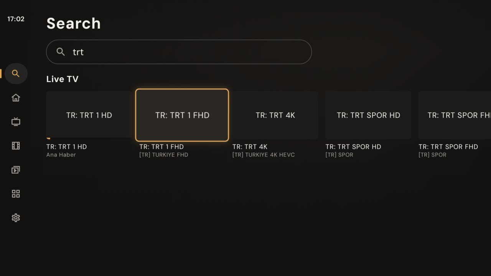
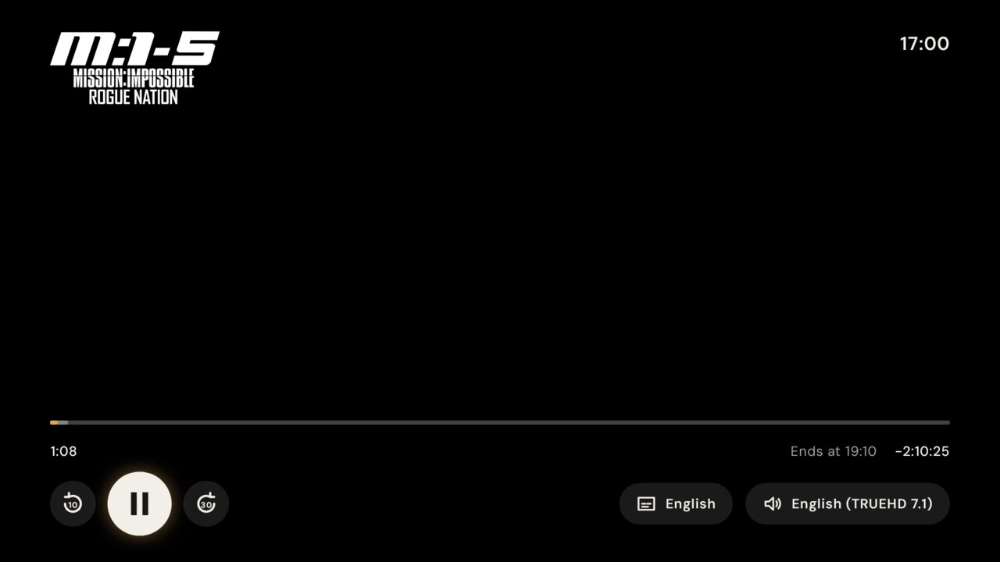
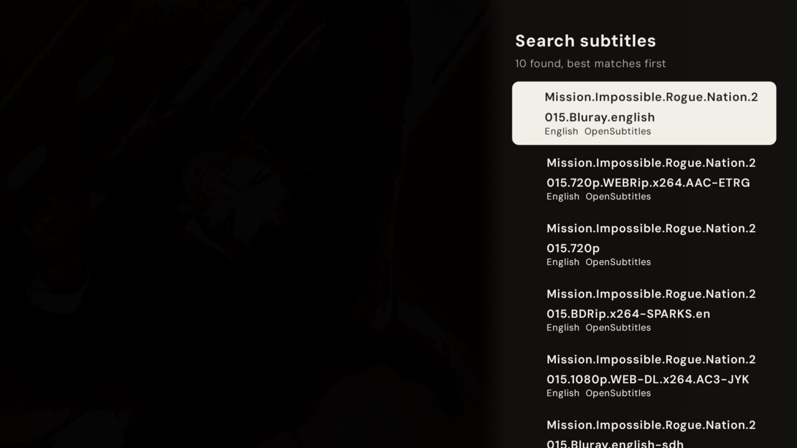

<p align="center"></p>

# Masal

A home screen app for Android TV that brings your Plex library, IPTV live TV and your favourite apps together in one calm interface, laid out the way Plex does it: the title's artwork and colours behind, its logo and details on the left, rows that open like an accordion below.

Masal runs as a normal app next to the system launcher, or as the device's home screen in its place (see [Home screen](#home-screen)). It was built on an NVIDIA Shield and is designed for a TV remote over HDMI-CEC, so everything works with the D-pad, OK, Back and play/pause.


## Features

- **Home**: your pinned apps, Continue Watching, one live TV row of a channel category you choose, and the Plex rows and collections you pick in Settings.
- **Movies and TV Shows**: per Plex library the tabs Recommended, Browse (sort, A–Z jump bar), Collections and Categories, plus detail pages with seasons and episodes.
- **Search** across all Plex libraries and the IPTV channel names, with the TV keyboard and voice input.
- **Live TV** from Xtream logins or M3U playlists with an XMLTV guide; channel switching with all four arrow keys. On Home a channel plays in the picture frame and zooms to full screen without reconnecting.
- **Plex player** with Plex-style controls, "Ends at" time, subtitle and audio selection, and online subtitle search through your Plex server; choices are saved to Plex. Subtitle look and skip lengths are adjustable.
- **Trailers** play in the background after resting on a title, when Plex has one.
- **Seerr** (optional): find and request films and series that are not in your library, as the person asking. Their trailers play in Masal's own player, from Plex or from YouTube.
- **Apps page** to pin and order the apps shown on Home.
- **Setup from the phone**: a QR code on the TV opens a setup page in the phone's browser for Plex and IPTV logins. Logins stay on the TV.
- **English, German and Turkish**, or the TV's own language.

## Screenshots

| | |
|---|---|
|  |  |
| TV Shows: Recommended | Browse with sorting and A–Z |
|  |  |
| Live TV row on Home | Search |
|  |  |
| Player | Subtitle search |

Screenshots are rendered from a real library by the JVM tests; artwork belongs to its respective owners.

## Requirements

- Android TV device with Android 8.0 (API 26) or newer.
- For Plex: your own Plex Media Server (link with a code at plex.tv/link, or enter URL and token).
- For live TV: your own IPTV subscription (Xtream login or M3U playlist). Masal does not include or point to any content.

## Build

You need JDK 17 and the Android SDK.

```sh
cp .env.dist .env        # then fill in TV_ADB (and JAVA_HOME / ANDROID_HOME if not set)
./gradlew assembleDebug  # build
scripts/install.sh       # build and install on the TV over network ADB
```

`scripts/install.sh` builds the app (the signed release build when the release key from `scripts/create-release-key.sh` is set up, otherwise the debug build), installs it, compiles it on the TV and opens it, also when the TV is in standby (it does not wake it, but the TV comes back to Masal instead of the previous app; `NO_START=1` installs only). Network ADB must be enabled on the TV (developer options) and this computer allowed once. An optional fallback through Home Assistant's Android TV integration can be configured in `.env`.

## First start

1. Open Masal and go to Settings.
2. Scan the QR code with your phone. The page only runs while Settings is open.
3. Link Plex with the code shown on the TV, or enter the server URL and token.
4. Add an Xtream login or an M3U playlist.
5. Optional: choose the channel category and title for the live TV row on Home.

## Home screen

Masal can replace the stock launcher. Android TV usually offers no chooser for this, so it is set over ADB:

```sh
adb shell cmd package set-home-activity com.alike.masal/.MainActivity
```

Some devices keep their stock launcher anyway (on an NVIDIA Shield it has system priority). Then the only way is to disable it (find its package with `adb shell cmd package resolve-activity -a android.intent.action.MAIN -c android.intent.category.HOME` before switching):

```sh
adb shell pm disable-user --user 0 <stock launcher package>
```

On the Shield the system's recommendations service then crashes repeatedly, since it expects the stock launcher, so disable it too:

```sh
adb shell pm disable-user --user 0 com.google.android.tvrecommendations
```

So that Masal comes back by itself when it crashes on screen, allow it to start from the background ("display over other apps"; Masal draws nothing over other apps). Android TV has no screen for this, so it is granted over ADB once; it stays through updates:

```sh
adb shell appops set com.alike.masal SYSTEM_ALERT_WINDOW allow
```

To go back, enable both again with `adb shell pm enable <package>`. Keep that command at hand: if the home screen fails to start, ADB is the way back. The device settings stay reachable through the "Android settings" tile and the button on Masal's Settings screen.

## Releases

Pushing a version tag builds a signed APK and publishes it as a GitHub release:

```sh
git tag v1.0.0 && git push origin v1.0.0    # tags with a hyphen (v1.1.0-beta.1) become pre-releases
```

The pipeline (`.github/workflows/release.yml`) runs the tests first. Before the first release, run `scripts/create-release-key.sh` once: it creates the signing key outside the repository, stores its password in `.env` and sets the repository secrets. Keep a backup of the key and password; updates of a released app can only be signed with the same key.

## Development

- Feature behaviour is described in [`docs/specs/`](docs/specs/README.md); conventions and architecture notes for contributors (and coding agents) are in [`CLAUDE.md`](CLAUDE.md).
- `./gradlew testDebugUnitTest` runs the UI tests on the JVM with Robolectric and writes screenshots, no TV needed. One suite uses a snapshot of your own library (`snapshot/`, never committed) and is skipped without it.

## Fonts, logo and licences

- [DM Sans](https://fonts.google.com/specimen/DM+Sans) for the interface and [Fraunces](https://fonts.google.com/specimen/Fraunces) for the wordmark, both under the SIL Open Font License; see [`licenses/`](licenses/).
- Background photos for apps come from Bing's photo of the day, credited on screen.
- Logo: [`docs/images/logo.png`](docs/images/logo.png) (square, on its background) and [`docs/images/logo-mark.png`](docs/images/logo-mark.png) (transparent mark).

Masal is an independent project and is not affiliated with or endorsed by Plex, Inc. or NVIDIA.

## License

The code is released under the [GNU General Public License v3.0 or later](LICENSE). Versions up to and including commit `8fbed54` were released under the MIT License. The bundled fonts keep their own SIL Open Font License (see [`licenses/`](licenses/)).

Masal uses [NewPipe Extractor](https://github.com/TeamNewPipe/NewPipeExtractor) (GPL-3.0) to play YouTube trailers in its own player.
